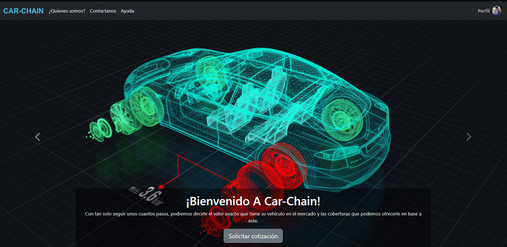
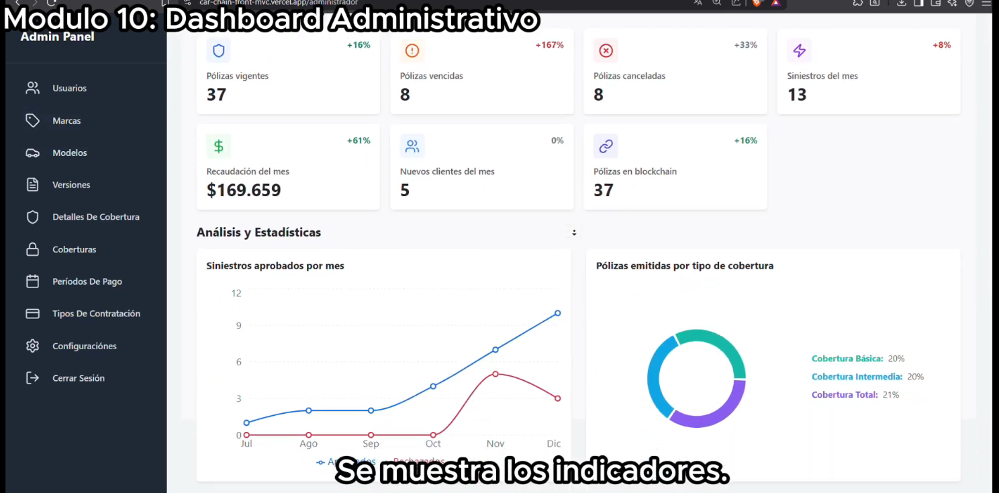

# Car-Chain — Aplicación web

Interfaz del sistema de gestión de pólizas de seguro vehicular Car-Chain: cotización y emisión de pólizas, gestión de siniestros y verificación de documentos contra la red Polygon.

Proyecto final de la carrera de Ingeniería en Sistemas de Información — Universidad Tecnológica Nacional, Facultad Regional Tucumán.

**[Ver demostración en video]([https://www.youtube.com/watch?v=fzim2_93Q-U])** · API: **[car-chain-back-MVC](https://github.com/JuanCarriles/car-chain-back-MVC)**



---

## El problema

En el seguro vehicular, buena parte de los conflictos entre asegurado y aseguradora se reduce a una pregunta: qué decía exactamente la póliza y desde cuándo. Los registros viven en los sistemas de la propia aseguradora, que es a la vez parte interesada en la disputa.

Car-Chain ancla cada operación crítica en una blockchain pública: la aseguradora opera con normalidad, pero ninguna de las partes puede alterar el registro después. Esta aplicación es la cara visible de ese sistema, tanto para el asegurado como para la aseguradora.

## Qué hace

**Cliente**
- Registro, inicio de sesión y edición de la cuenta
- Solicitud de contratación de póliza y consulta de la cotización
- Pago de la póliza
- Reporte de siniestros con carga de documentación
- Consulta de la póliza registrada en blockchain
- Consulta del historial del vehículo

**Personal de la aseguradora**
- Aprobación de pólizas solicitadas
- Aprobación de revisiones
- Validación de reportes de siniestro

**Administrador**
Panel de configuración del sistema: catálogo de vehículos (marcas, modelos y versiones), coberturas y sus detalles, tipos de contratación, períodos de pago, y los parámetros de riesgo que alimentan la cotización — franjas de edad del conductor, antigüedad del vehículo y localidad. Además cuenta con un dashbord con métricas útiles de la aseguradora y la capacidad de imprimir informes semestrales o trimestrales.



## Stack

| Tecnología | Rol |
|---|---|
| React + TypeScript | Interfaz |
| Vite | Build y servidor de desarrollo |
| Vercel | Deploy |

## Arquitectura

La aplicación está organizada según una separación al estilo MVC, poco habitual en React y adoptada por consigna académica:

- **Modelos** — acceso a datos y llamadas a la API; encapsulan el contrato con el backend.
- **Vistas** — componentes de presentación, sin lógica de negocio.
- **Controladores** — hooks y contenedores que coordinan modelos y vistas.

```
src/
 ├── models/
 ├── views/
 ├── controllers/
 ├── redux/
 ├── utils/
 └── App.tsx
```

### Evaluación de esta decisión

Aplicar MVC estricto sobre React tiene un costo real: el ecosistema tiende a organizarse por funcionalidad y no por capa técnica, y los hooks ya cumplen buena parte del rol de controlador, así que la separación agrega una indirección que el framework no pide.

A favor: aisló con claridad el contrato con la API, lo que resultó útil cuando el backend cambió, y facilitó explicar la arquitectura en la defensa del trabajo.


## Historia del proyecto

Una primera versión del sistema se desarrolló con Java web sobre JSP y anclaje en Ethereum. En poco más de un año dejó de funcionar: el stack quedó desactualizado y el costo de las transacciones en Ethereum volvía imprevisible operar el sistema.

La reescritura completa sobre React y Polygon respondió a las dos cosas: comisiones de red órdenes de magnitud menores y confirmaciones más rápidas, sobre un ecosistema donde frontend y backend comparten lenguaje y tipos. El detalle de la migración está en el [README del backend](https://github.com/JuanCarriles/car-chain-back-MVC).

## Documentación

El desarrollo está documentado en el informe de tesis: análisis, diseño, desarrollo y pruebas, con casos de uso, modelo de dominio, diagramas de secuencia, mockups, manual de usuario, entre otros artefactos.

📄 **[Informe completo (PDF)](UTN-FRT_ProyectoFinal_CAR-CHAIN.docx.pdf)**

## Correrlo localmente

```bash
git clone https://github.com/JuanCarriles/car-chain-front-MVC.git
cd car-chain-front-MVC
npm install
cp .env.example .env      # apuntar a la API
npm run dev
```

Abrir http://localhost:5173

Requiere el backend corriendo: ver [car-chain-back-MVC](https://github.com/JuanCarriles/car-chain-back-MVC).

## Estado

Proyecto académico finalizado y defendido. El despliegue de demostración ya no está activo; el funcionamiento completo puede verse en el [video de demostración]([https://www.youtube.com/watch?v=fzim2_93Q-U]).

El seguimiento del desarrollo quedó registrado en los issues del repositorio.

El seguimiento del desarrollo quedó registrado en los [issues](https://github.com/JuanCarriles/car-chain-front-MVC/issues) del repositorio.

---

Desarrollado por [Juan M. Carriles](https://www.linkedin.com/in/juan-maria-carriles-8836512a2/) · juanmcarrile@gmail.com
